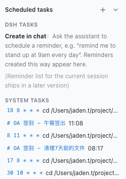
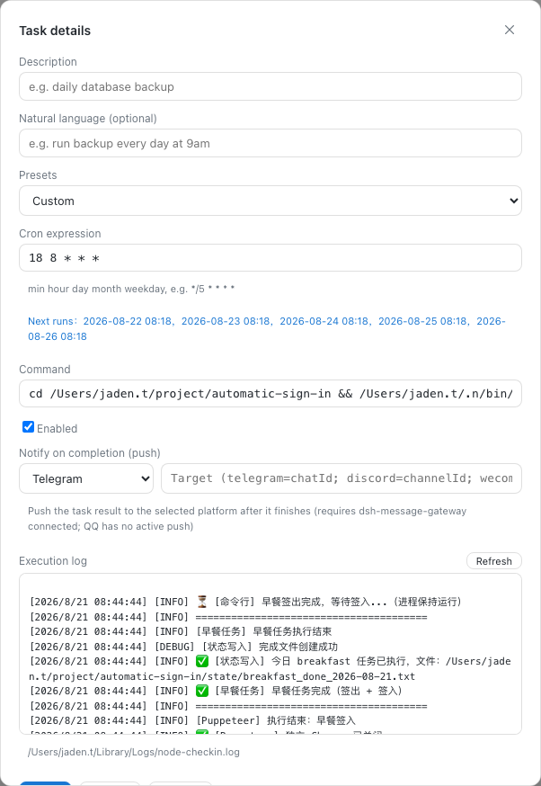

# dsh-cron-panel

[中文](README.md) · [Español](README.es.md)

A scheduled-tasks panel for the DSH Web GUI: sits between the workspace selector and settings in the sidebar, managing DSH tasks and system tasks (crontab) in separate sections, with natural-language creation, full-screen detail editing, and execution logs.

## Features

- **Sidebar panel**: below the workspace selector, above settings; ➕ on the header to create, ▾ to collapse (collapses to a slim title bar; state is persisted)
- **Separate sections & status indicators**: DSH tasks and system tasks are shown apart, with status indicator dots (🟢 success / 🔴 failure / ⚪ not run yet)
- **Execution logs & one-click clear**: panel-created tasks log automatically with live refresh and a one-click "Clear logs" button to prevent file bloat
- **Natural-language creation**: type “run backup every day at 9am”, “clean temp files every 30 minutes”, “every Monday at 8pm” and it is parsed into a cron expression automatically; manual expressions also supported
  - **Instant local parsing**: common Chinese/English phrasings resolve with zero latency, and the extracted "what to do" is auto-filled into the Agent Prompt
  - **LLM fallback refinement** (new in v0.1.12): languages and phrasings the local patterns cannot cover (Japanese, Korean, complex sentences) are parsed by your default model; when no model is configured or the call fails it silently falls back to the local result
- **Full-screen details**: click a task to open a full-screen overlay over the conversation, close via the top-right ✕; edit / save / delete / enable-toggle supported
- **Next-run preview**: while editing, the next 5 execution times are shown automatically from the cron expression (avoids typos)
  - Fixed in v0.1.12: expressions like `30 13 * * 3` (every Wednesday 13:30) used to be previewed as "every day" because of a wrong day-of-month/day-of-week comparison; now corrected per the cron spec, and the scan advances day by day so rare expressions (e.g. `0 0 29 2 *`) no longer block
- **Agent Prompt Automation**: In addition to standard Shell commands, switch to "🤖 Agent Prompt Automation" mode to run an AI prompt on schedule in the background (e.g. daily code inspection or morning briefing) and push findings directly to WeCom or Telegram
- **Notify on completion**: when editing a task you can configure "notify on completion" — after the task finishes, the result is pushed to the selected platform (Telegram / Discord / WeCom AI bot / Email); requires an installed and connected `dsh-message-gateway` (QQ has no active push). Push goes through the gateway's `/gateway/push`; the cron command gets a push segment appended automatically (exit code + task description), no extra setup needed
  - Note (v0.1.12): **Agent Prompt tasks skip this auto-push**. The agent session already emits messages, so re-pushing them through the notify hook produced duplicate noise; ask the agent to call a push tool inside the prompt when you want a reminder
- **Run now**: in task details, click "Run now" to execute the command once immediately (not through cron scheduling) and see the exit code and output — verify a task right after creating it instead of waiting for its schedule
  - Note (v0.1.12): currently Shell commands only. Agent Prompt tasks return a notice instead of spawning the session (avoiding a long silent wait); streaming execution for agent tasks is planned for a later release
- **Auto-retry on failure**: configure the number of retries and the delay between attempts (the command runs in a subshell, so a failed exit code triggers a retry)
- **Auto-backup before write**: every crontab rewrite is preceded by a backup of the current content to `~/.local/share/dsh-cron-backups/` (keeps the latest 20), so mistakes can always be rolled back

- **Multilingual**: follows the DSH Web UI language (Chinese / English); Spanish browsers automatically get Spanish copy; defaults to Simplified Chinese
- **Cross-Platform & Theme Adaptations**:
  - Seamless Windows compatibility: avoids `spawn /usr/bin/crontab ENOENT` errors by supporting local persistence fallback.
  - Enhanced contrast and color variables across light and dark modes to prevent invisible text.
- Light / dark theme follows the DSH Web GUI

## Screenshots

**Sidebar panel** (DSH / system sections + add + collapse):



**Full-screen details** (edit form + execution log, close top-right):



## Installation

```sh
dsh plugin --profile web add dsh-cron-panel
```

Restart `dsh web`, and the “Scheduled tasks” panel appears below the workspace selector in the sidebar.

> For local development, install via a link instead: `dsh plugin --profile web add link:/path/to/dsh-cron-panel`. After editing source, run `npm run build` and refresh the page to see changes.

## Feedback

Found a bug or have a feature request? Open an issue on [GitHub Issues](https://github.com/a792883583/dsh-cron-panel/issues) — your feedback helps us make the plugin better.

## License

MIT
